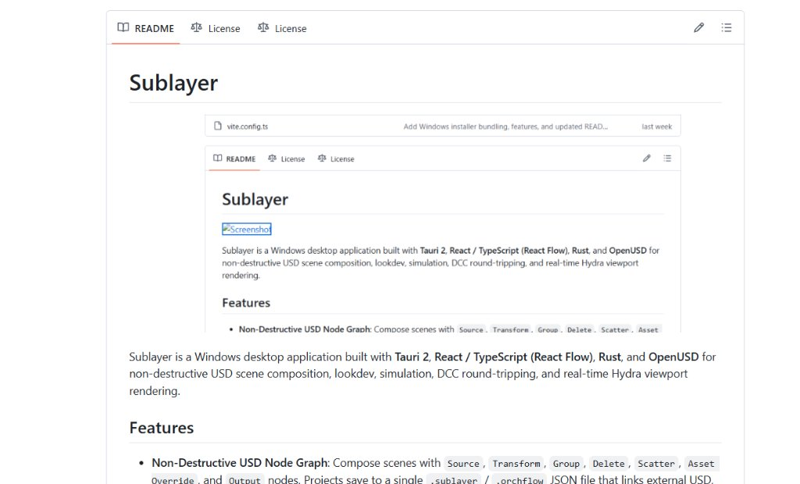

# Sublayer



Sublayer is a Windows desktop application built with **Tauri 2**, **React / TypeScript (React Flow)**, **Rust**, and **OpenUSD** for non-destructive USD scene composition, lookdev, simulation, DCC round‑tripping, and real‑time Hydra viewport rendering.

## Features

- **Non-Destructive USD Node Graph**: Compose scenes with `Source`, `Transform`, `Group`, `Delete`, `Scatter`, `Asset Override`, and `Output` nodes. Projects save to a single `.sublayer` / `.orchflow` JSON file that links external USD, texture, and DCC files in place without copying or mutating originals.
- **Instancer node**: Place multiple instances of a source USD asset with per‑instance transforms, selection, duplicate, delete, and undo/redo. Supports viewport drag‑and‑drop and numeric entry.
- **Scatter node**: Generate large numbers of instances automatically using grid, radial, or custom distributions, with optional randomization of position, rotation, scale, and seed. Ideal for foliage, crowds, and debris.
- **Megascans / Fab integration**: Browse, download, and import assets from Quixel Megascans/Fab Library directly into the central library. Drag assets onto the canvas to create Instancer or Scatter nodes, with automatic texture/material linking via MaterialX.
- **Multi-Renderer Hydra Viewport**:
  - **OpenUSD Storm**: Upstream Hydra Storm rasterized viewport.
  - **Autodesk Aurora (`hdAurora`)**: Open-source DirectX 12 DXR / Slang path-traced Hydra delegate (bundled in the Windows installer).
  - **NVIDIA Omniverse RTX (`ovrtx` / `ovstage`)**: Optional isolated RTX path-traced renderer.
  - Interactive orbit/pan/dolly, transform & camera gizmos, prim selection/isolation, scene overview, and GPU cache controls (`Reload stage`, `Flush GPU`).
- **Materials & Shading**: `MaterialX` authoring (Standard Surface with `UsdPreviewSurface` fallback, procedural shading rules, `.mtlx` export) and `Material Bind` nodes, with selective Auto/Scene/Solid material preview diagnostics for missing shader assets.
- **Hair, Cloth & Character Tools**: `Hair` node (NVIDIA Warp GPU physics simulation and guide-based interactive grooming), `Cache Sculptor` (`cache_edit` for cloth physics brushing and full‑garment GPU cloth simulation), and `Character` nodes.
- **MetaHuman DNA source**: Select a head or body `.dna` and LOD. Epic OpenRigLogic reads legacy and UE 5.6+ DNA into anonymous USD meshes with UV seams, normals, skeleton rest/bind transforms, skin weights and sparse blend shapes. Original DNA stays linked in the registry. Facial RigLogic/body correctives are not evaluated; textures, materials, grooms and clothes are separate assets.
- **Pose node & Live Pose Editing**: Map upstream skeletons to loaded USD animations or poses in an inspector table, edit poses directly with the interactive viewport pose editor, and stream real-time `livePose` delta updates in Omniverse RTX. Switch entries, bypass individual mappings, play clips, or sample a fixed pose frame. Compatible joint names are required; no automatic retargeting. External animation assets stay linked in place.
- **Lighting, Cameras & PostFX**: `Light` (with physical light units), `HDRI`, `Camera`, and `PostFX` nodes (tone mapping including ACES, Hable Filmic, Heji‑Hable ALU, Reinhard, and Iray, plus color grading and per‑channel RGB controls).
- **DCC & Application Round Trips**:
  - **Blender**: Importer & `Application` round trips with explicit handoff export, reversible coordinate/axis conversion snapshots, baseline comparison, selective sparse adjustment publishing, upstream reconciliation, and MaterialX node‑tree extraction.
  - **Substance 3D Painter 2023+**: One‑click `sublayer_bridge` plugin installation, creating/opening `.spp` projects directly from a handoff USD, and exporting/syncing painted PBR textures back into Sublayer as a MaterialX layer (`sp_materials.py`).
  - **Additional Profile Templates**: ZBrush (GoZ) and Marvelous Designer.
- **Local MCP Server**: `orchflow-mcp` exposes headless USD inspection, stage composition, and rendering over stdio.

---

## Installation

### Option 1: Prebuilt Windows Installer (Recommended)

1. Download the latest `Sublayer_*_x64-setup.exe` installer from the [GitHub Releases](https://github.com/ruchirlives/Sublayer/releases) page.
2. Run the installer. It installs **Sublayer** and the bundled **Autodesk Aurora** Hydra delegate (`renderers/aurora`).
3. At the end of installation (or anytime from the Start Menu via **Sublayer Runtime Setup**), the optional runtime wizard (`scripts/installer-runtimes.ps1`) lets you install:
   - **`uv`** (Python & package manager)
   - **OpenUSD 25.08 + Hydra Storm** (required for 3D USD evaluation and Storm rendering — downloaded directly from NVIDIA's official OpenUSD release with SHA‑256 verification)
   - **NVIDIA Omniverse RTX** (optional, for RTX GPUs — installs `ovrtx` and `ovstage` into an isolated Python 3.12 environment)

### Option 2: Building from Source (Windows)

#### Prerequisites

- **Node.js & npm** (for the React + TypeScript + Vite frontend)
- **Rust & Cargo** (`edition = "2024"`, Tauri v2 desktop backend, Windows WebView2 & MSVC build tools)
- **Python + OpenUSD** (for the USD graph, MaterialX, simulation, and Hydra viewport workers)
- **Optional: NVIDIA Omniverse RTX (`ovrtx` / `ovstage`)** (for RTX path‑traced viewport rendering)

#### 1. Install Frontend Dependencies

```powershell
npm install
```

#### 2. Configure OpenUSD / Hydra Python Environment

The Rust backend launches the primary USD worker using:

- `ORCHFLOW_PYTHON` — Path to the Python executable (defaults to `python` on `PATH`)
- `ORCHFLOW_USD_ROOT` — Path to your OpenUSD installation root (adds `lib/python` to `PYTHONPATH`, `bin`/`lib` to `PATH`, and defaults `PXR_MTLX_STDLIB_SEARCH_PATHS` to `libraries`)

Example (PowerShell):

```powershell
$env:ORCHFLOW_PYTHON = "path\\to\\python.exe"
$env:ORCHFLOW_USD_ROOT = "I:\\AI\\OpenUSD-runtime\\25.08"
```

> **Note:** For `.abc` (Alembic) source stages when `usdAbc` is not in the primary OpenUSD build, `worker/usd_graph.py` can invoke an imaging runtime via `ORCHFLOW_IMAGING_PYTHON` or `.venv-imaging\Scripts\python.exe`.

#### 3. Optional: Configure NVIDIA Omniverse RTX (`ovrtx`)

Omniverse RTX runs in a separate isolated Python environment (`.venv-ovrtx`) to avoid ABI or symbol collisions with upstream OpenUSD / Hydra:

1. Create `.venv-ovrtx` at the repository root (or point `ORCHFLOW_OVRTX_PYTHON` to an existing Python executable):

```powershell
python -m venv .venv-ovrtx
.\.venv-ovrtx\Scripts\Activate.ps1
pip install numpy pillow
```

2. Install the `ovrtx`, `ovstage`, and OpenUSD (`pxr`) packages into `.venv-ovrtx` according to your Omniverse RTX SDK distribution.
3. Point `ORCHFLOW_OVRTX_ROOT` to the external Omniverse RTX runtime directory containing `runtime.json` (defaults to `I:/AI/OrchFlow-renderers/ovrtx`).

#### 4. Build, Launch & Bundle

- **Build and launch debug app** (builds frontend, `sublayer-updated.exe`, and `orchflow-mcp.exe` to `I:/AI/OrchFlow-build/debug/`):

```powershell
.\scripts\build-and-launch.ps1
```

- **Build only**:

```powershell
.\scripts\build.ps1
```

- **Build Windows NSIS installer** (stages open‑source Autodesk Aurora if present and outputs the setup `.exe` under `$env:CARGO_TARGET_DIR\release\bundle\nsis\`):

```powershell
.\scripts\bundle-windows.ps1
```

- **Development & tests**:
  - Frontend dev server: `npm run dev`
  - Frontend build: `npm run build`
  - Frontend tests: `npm test`
  - Rust tests: `cargo test --manifest-path src-tauri/Cargo.toml`

---

## License & Caveats

Sublayer is licensed under the **GNU General Public License v3.0 or later (`GPL-3.0-or-later`)**. See [`LICENSE`](LICENSE) for the full license text.

### Licensing Caveats & Third‑Party Runtimes

1. **NVIDIA Omniverse RTX Linking Exception ([`LICENSE-EXCEPTION.md`](LICENSE-EXCEPTION.md))**:
   - Under GNU GPLv3 Section 7, an additional permission is granted to combine or link Sublayer with the external proprietary NVIDIA Omniverse RTX runtime libraries (`ovrtx` and `ovstage`).
   - Those proprietary libraries are **not** included in this repository or in the prebuilt Windows installer; end users must obtain them separately under NVIDIA's license terms.
2. **Autodesk Aurora (`hdAurora`)**:
   - The Windows installer stages the open‑source Autodesk Aurora Hydra delegate (`scripts/bundle-windows.ps1`) and explicitly removes proprietary NVIDIA MDL SDK DLLs (`libmdl_*.dll`) before packaging.
3. **External Optional Runtimes**:
   - OpenUSD, `uv`, Python packages, and optional NVIDIA packages installed via `scripts/installer-runtimes.ps1` are downloaded directly by the user from their respective official upstream sources and remain governed by their own licenses.

## Fab Browser and central asset library

Configure **Applications → Megascans / Fab library**, then save the application settings. Library paths and multiple external‑browser Downloads folders live in the shared `applications.json`. On first use Sublayer detects `I:\\EpicGames\\Megascans` if it exists and the Windows Downloads known folder, including relocated folders.

**◈ Megascans / Fab** opens the local library panel. **Fab Browser** opens a separate embedded browser with a persistent WebView2 login profile, navigation buttons, and the configured download location. Sign in yourself and complete any site verification in that window. Use Fab's own Download button and format picker. Fab has no public download API.

Completed embedded‑browser downloads are redirected into the central library, indexed, and added to the graph. An unambiguous pending listing drop is filled first. External‑browser Downloads folders and files placed directly in the library root are watched while a canvas listing drop is pending or Fab Browser is open.

Rescan discovers custom nested folders up to six levels deep. Loose ZIPs are safely extracted beside the archive, which is retained. Existing extraction folders are preserved. Asset folders retain their variations, previews, and shared texture links. No project asset copies are created.

Desktop acceptance remains manual: sign in and download an asset in Fab Browser, confirm library indexing and a selected graph node, drag a Fab listing card onto the canvas, save library settings in Applications, and Rescan an extracted asset in a nested custom folder.

## Manual instance placement

Connect a scene to an **Instancer** node and preview its output. Select the node, enter **Scene** mode, and **Alt + left‑drag** an existing object to create one shared USD reference instance. Alt‑drag a created placement to duplicate its transform. A small drag threshold prevents accidental overlapping copies. Clicking a placement selects it for the existing **W / E / R** move/rotate/scale gizmo; **Delete** removes only placements owned by this node. **Escape** cancels a drag and **Undo/Redo** operate on completed gestures.

The inspector defaults to **Ground plane**, preserving starting height along the active Y/Z up axis. Choose Free, X/Y/Z only, or custom axis locks; constraints affect world‑space translation, while rotation/scale remain available. The instance list provides visibility, source prim relinking, numeric transforms and Duplicate/Delete. Numeric coordinates allow explicit placement. **Edit instances** disables/enables these viewport tools; an unrelated pinned preview offers **Preview this node**.

Original objects pass through, geometry/materials remain referenced, and placement records live in the single project JSON. Picking inside an existing USD instance selects its containing instance root. Skeletal/skinned subtrees and individual PointInstancer points are unsupported and report errors. Storm/RTX rendering and picking have headless coverage; desktop gesture feel and large‑scene drag performance still require manual verification.
